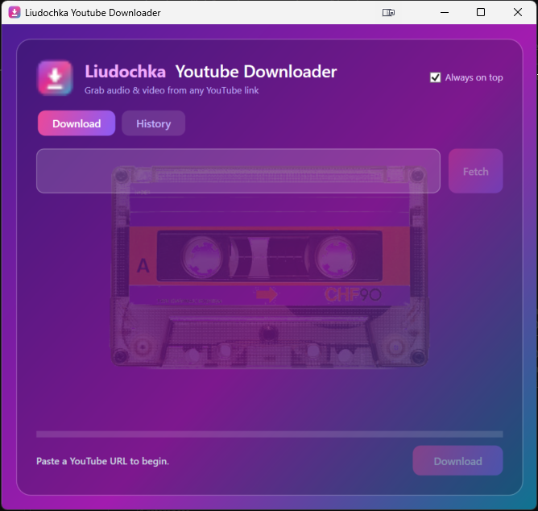

# 🎀 Liudochka Youtube Downloader

A small, friendly Windows desktop app for grabbing **audio and video from any YouTube link** — pick a format, pick a quality, and download. Built on .NET 8 with a frosted-glass cassette theme. Ships as an **Avalonia** app with in-app updates.




## Features

- **Download audio or video** — save audio as **MP3** (best-quality VBR by default, or a fixed bitrate) or **Opus** (native, no re-encode), or **video** (selectable quality).
- **Open in foobar2000** — from any history entry with a saved file, open it in foobar2000 (button is disabled with a tooltip when foobar2000 isn't installed).
- **Fetch first** — paste a link and see the title, author, and thumbnail before committing to a download.
- **Smart quality hints** — warns you when the requested quality would upscale beyond what the source offers.
- **Live progress** — a gradient progress bar tracks download + conversion.
- **Clipboard detection** — spots a YouTube link on your clipboard and offers to use it.
- **History** — every download is remembered, **grouped by date** and **searchable** by title or link. From any entry you can:
  - **Use** — drop the link back into the download box
  - **Open** — open the video in your browser
  - **Folder** — reveal the saved file in Explorer
  - **Remove** a single entry
  - **Clear all** — now asks for confirmation first.
- **Check for updates** — a header button checks GitHub Releases and downloads the newest build for you to swap in.
- **Remembers your last save folder** so you're not re-navigating every time.
- **Always-on-top toggle** (on by default, persisted across restarts).
- **No manual FFmpeg setup** — the required FFmpeg binaries are downloaded automatically on first use.

## Requirements

- **Windows** — the Avalonia build ships as a Windows x64 single file.
- **[.NET 8 SDK](https://dotnet.microsoft.com/download/dotnet/8.0)** — only needed to build/run from source. A published release is self-contained and needs no .NET install.

## Getting started (from source)

```sh
git clone https://github.com/VitakSharper/YoutubeDownloader.git
cd YoutubeDownloader

# Run the app
dotnet run --project YoutubeDownloader.Avalonia

# Run the tests
dotnet test
```

FFmpeg is fetched automatically into `%LocalAppData%\YoutubeDownloader\ffmpeg` the first time it's needed.

## Building a standalone release

A single self-contained `.exe` (no .NET runtime required on the target machine) can be produced with the included script:

```sh
release.cmd    # -> dist\LiudochkaYoutubeDownloader.Avalonia.exe
```

It runs a Release publish for `win-x64` (single file, compressed) into `dist\`.

## In-app updates (Avalonia)

The Avalonia app has a manual **Check for updates** button in the header that queries this repo's GitHub Releases. To cut a release:

1. Bump `<Version>` in `YoutubeDownloader.Avalonia.csproj` (and `VERSION` in `release.cmd`).
2. Run `release.cmd` — it publishes the single-file exe and zips it to `dist\`.
3. Publish the release (public):
   `gh release create v<version> "dist\LiudochkaYoutubeDownloader.Avalonia-v<version>.zip" --title "v<version>" --notes "…"`

Users on an older build click **Check for updates** → **Download**; the app fetches the zip, extracts the new exe to their Downloads folder, and opens it in Explorer to swap in.

## Where your data lives

Everything is stored under `%LocalAppData%\YoutubeDownloader`:

| Path | Contents |
|------|----------|
| `ffmpeg\` | Auto-downloaded FFmpeg binaries |
| `history.json` | Your download history |
| `settings.json` | App settings (always-on-top, last save folder) |

Deleting that folder resets the app to a clean state.

## Project structure

```
YoutubeDownloader.sln
├─ YoutubeDownloader.Core/        Platform-agnostic logic (net8.0)
│  ├─ Services/                   YouTube access, FFmpeg, history, settings, updates, …
│  ├─ ViewModels/                 MVVM view models (CommunityToolkit.Mvvm)
│  ├─ Models/ · Helpers/ · Ffmpeg/
├─ YoutubeDownloader.Avalonia/    Avalonia UI (net8.0) — in-app updates
├─ YoutubeDownloader.Core.Tests/  Unit tests (xUnit + Moq)
└─ release.cmd                    Single-file release build
```

The UI is kept thin: all logic lives in `Core` behind interfaces and is wired up with `Microsoft.Extensions.DependencyInjection` in the app's composition root, which keeps the core testable.

## Built with

- [Avalonia](https://avaloniaui.net/) — cross-platform .NET UI
- [YoutubeExplode](https://github.com/Tyrrrz/YoutubeExplode) — YouTube metadata and stream access
- [Xabe.FFmpeg](https://github.com/tomaszzmuda/Xabe.FFmpeg) — media conversion + automatic FFmpeg download
- [CommunityToolkit.Mvvm](https://learn.microsoft.com/dotnet/communitytoolkit/mvvm/) — MVVM helpers

## Disclaimer

This is a personal hobby project and is **not affiliated with YouTube or Google**. Please download only content you have the right to, and respect YouTube's Terms of Service and applicable copyright law.
